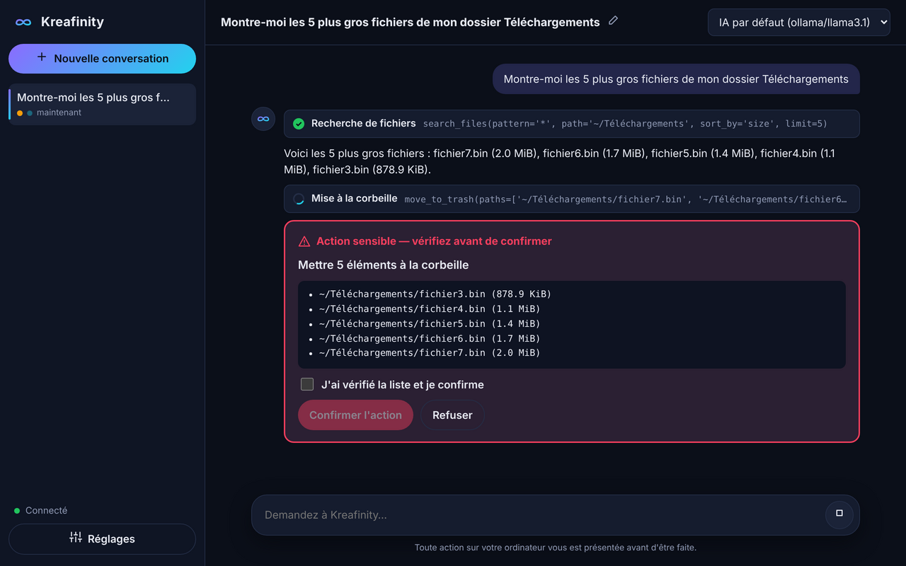
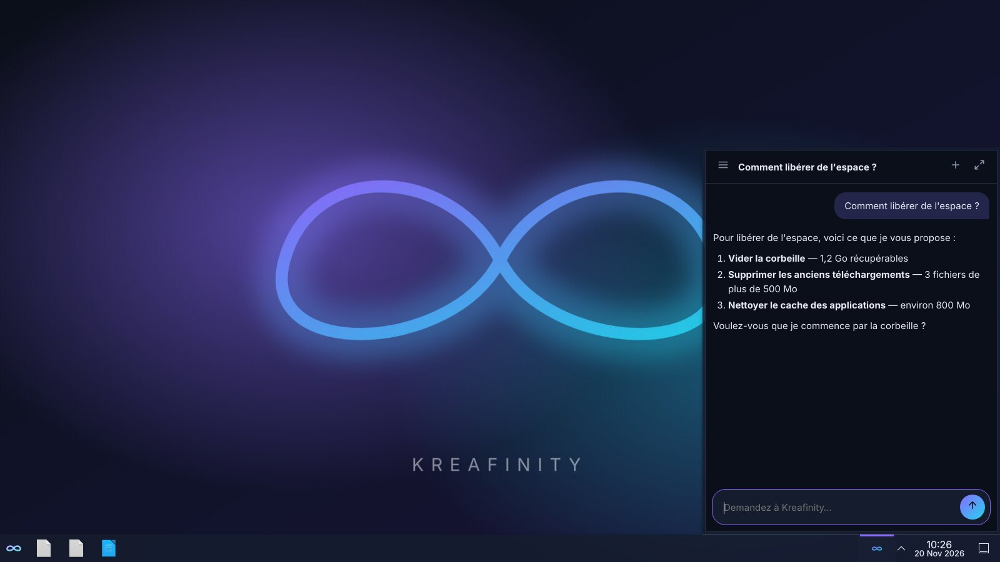

# ∞ Kreafinity OS

**Le système d'exploitation piloté par IA, où c'est vous qui choisissez votre IA.**
*The AI-driven operating system where you choose your AI.*

> 🚧 Projet en tout début de développement — *Early stage project*

---

## 🇫🇷 Français

### L'idée
Kreafinity OS est une distribution Linux open source dont l'intelligence artificielle est au cœur de l'expérience. Vous parlez à votre ordinateur pour lancer des applications, ranger vos fichiers ou régler votre système, dans une interface familière inspirée de Windows.

### Pourquoi Kreafinity OS ?
- 🔓 **Liberté du fournisseur IA** : Claude, GPT, Mistral, Ollama Cloud, les centaines de modèles d'OpenRouter, ou un modèle 100 % local avec Ollama. Vous changez quand vous voulez.
- 🛡️ **Vous gardez le contrôle** : aucune action sensible (suppression, commande système, installation) sans votre validation.
- 🧠 **Une mémoire qui s'améliore** : Kreafinity se souvient de vous et apprend de chaque conversation, comme Hermes Agent ; vous pouvez tout lire, corriger ou effacer ([docs/memoire.md](docs/memoire.md)).
- 🎙️ **La voix** : parlez-lui avec le micro, il vous répond à voix haute ; reconnaissance et voix sur l'ordinateur, sans rien envoyer ([docs/voix.md](docs/voix.md)).
- 👀 **Il voit votre écran, si vous le voulez** : « c'est quoi ce message d'erreur ? » — il demande la permission pour chaque capture, puis vous guide ([docs/outils.md](docs/outils.md#regarder-lécran-look_at_screen)).
- 🧭 **Il vous guide sur le web** : dans sa propre fenêtre de navigateur, il vous montre où cliquer, ou remplit les formulaires pour vous avec votre accord — jamais vos mots de passe ([docs/outils.md](docs/outils.md#le-navigateur-de-lassistant-browser_open-browser_read-browser_point-browser_act)).
- 🕹️ **Le mode pilote** : avec votre accord, il prend la souris et le clavier pour faire à votre place pendant que vous regardez ; un bandeau reste affiché, et Échap ou un mouvement de souris vous rend la main ([docs/outils.md](docs/outils.md#le-mode-pilote-pilot_start-pilot_act-pilot_stop)).
- 🧩 **Des extensions (MCP)** : branchez des centaines d'outils existants (agenda, mails, GitHub, domotique…) grâce au standard MCP ; chacun demande votre accord ([docs/mcp.md](docs/mcp.md)).
- ✨ **Une âme** : Kreafinity a sa propre personnalité, qu'il construit lui-même au fil de vos échanges (plus taquin, plus bref…), sans jamais toucher à ses règles ; vous pouvez la lire, la modifier ou la réinitialiser.
- 🔒 **Vie privée** : fonctionne entièrement hors ligne avec un modèle local.
- 🪟 **Interface familière** : barre des tâches, menu démarrer, fenêtres… avec l'IA intégrée partout.
- 🌍 **Open source** : construit sur Linux (Debian), ouvert aux contributions.

### Feuille de route
- [ ] **Étape 1** — Assistant système multi-LLM (démon, CLI, interface web de chat)
- [ ] **Étape 2** — Bureau façon Windows avec IA intégrée
- [ ] **Étape 3** — Distribution bootable (ISO, clé USB live, installateur) : le paquet Debian est prêt ([docs/distribution.md](docs/distribution.md))

### Installer
Sur Debian, Ubuntu et dérivées, une seule commande (sans `sudo`) :
```bash
curl -fsSL https://raw.githubusercontent.com/LAWD-CREATION/kreafinity-OS/main/packaging/install.sh | bash
```
Kreafinity s'installe dans votre dossier personnel, démarre avec votre session, s'ajoute au menu
des applications et vous demande quelle IA utiliser : Ollama (sur l'ordinateur, gratuit et privé),
Ollama Cloud, Claude, GPT, Mistral ou OpenRouter. Options, emplacements, mise à jour et dépannage :
[docs/installation.md](docs/installation.md). Pour désinstaller : `kreafinity uninstall`
(`--purge` efface aussi vos réglages et conversations).

Ou avec le **paquet Debian**, pour tous les utilisateurs et avec les mises à jour du système
(voir [docs/distribution.md](docs/distribution.md)) :
```bash
curl -fsSLo /tmp/kreafinity.deb https://lawd-creation.github.io/kreafinity-OS/kreafinity_latest_amd64.deb
sudo apt install /tmp/kreafinity.deb
```

### Utiliser
```bash
kreafinity ui             # ouvre l'interface web dans votre navigateur (ou « Kreafinity » dans le menu)
```



L'interface web montre les réponses en direct, vous laisse choisir l'IA et vous présente chaque
action sur l'ordinateur avant qu'elle ne soit faite : une suppression demande de cocher une case
puis de confirmer. Elle fonctionne sans connexion Internet et sans jeton : le démon reconnaît
votre propre navigateur.

Sur le bureau, une **bulle** reste en bas à droite de l'écran : un clic ouvre un petit panneau
pour poser une question, un nouveau clic le referme. Une pastille orange signale une action qui
attend votre accord.
L'installation l'affiche à chaque ouverture de session ; sinon :
```bash
kreafinity bubble                         # affiche la bulle (kreafinity bulle marche aussi)
kreafinity bubble --autostart             # l'afficher à chaque ouverture de session
```

**Sur KDE Plasma** (étape 2, en cours), Kreafinity s'intègre au bureau : une question tapée dans
le menu démarrer est envoyée à l'assistant, un bouton ∞ dans la barre des tâches (ou Meta+C)
ouvre le panneau, un clic droit sur des fichiers propose de les expliquer, les résumer ou les
ranger, l'assistant change le thème (clair, sombre, Kreafinity) et le fond d'écran à la demande, range
les fenêtres (côte à côte, réduites, au premier plan),
et un thème Kreafinity donne au bureau une disposition à la façon de Windows. Détails :
[docs/bureau-kde.md](docs/bureau-kde.md).
```bash
kreafinity desktop install --theme        # recherche, bouton de la barre des tâches, couleurs
```



En ligne de commande :
```bash
kreafinity ask "Quels sont les 5 plus gros fichiers de mon dossier Téléchargements ?"
kreafinity chat                           # conversation ; /fournisseur anthropic pour changer d'IA
kreafinity history                        # vos conversations ; chat --reprendre <id> pour continuer
```

Avec une IA en ligne, enregistrez votre clé dans le **trousseau système** (jamais dans un fichier),
depuis les réglages de l'interface ou ainsi :
```bash
kreafinity provider key anthropic         # Claude (ou openai, mistral, ollama-cloud, openrouter)
kreafinity provider use anthropic         # IA par défaut
kreafinity provider list                  # fournisseurs, clés, IA par défaut et de secours
```
Pour basculer automatiquement sur un modèle local quand Internet ne répond pas, choisissez une IA
de secours dans les réglages (ou `fallback: ollama/llama3.1` dans `~/.config/kreafinity/config.yaml`).

Toute action qui modifie l'ordinateur (créer, déplacer, ouvrir, régler le volume ou la luminosité, changer le thème ou le fond d'écran,
mettre à la corbeille, exécuter une commande, installer un logiciel…) vous est d'abord présentée
et ne s'exécute qu'avec votre accord. Liste des outils et garde-fous : [docs/outils.md](docs/outils.md).
Journal des actions : `~/.local/share/kreafinity/actions.log`. API locale du démon :
[docs/api.md](docs/api.md).

### Contribuer
Le projet démarre : idées, retours et contributions sont les bienvenus via les *issues* et *pull requests*.
Version de développement :
```bash
git clone https://github.com/LAWD-CREATION/kreafinity-OS && cd kreafinity-OS
python3 -m venv .venv && source .venv/bin/activate && pip install -e ".[dev]"
pytest
```
Guides : [bureau KDE Plasma](docs/bureau-kde.md), [ajouter un fournisseur d'IA](docs/ajouter-un-fournisseur.md),
[ajouter un outil](docs/ajouter-un-outil.md), [interface web](docs/interface-web.md).

---

## 🇬🇧 English

### The idea
Kreafinity OS is an open source Linux distribution with artificial intelligence at the heart of the experience. Talk to your computer to launch apps, organize files or adjust settings, in a familiar Windows-inspired desktop.

### Why Kreafinity OS?
- 🔓 **Freedom of AI provider**: Claude, GPT, Mistral, Ollama Cloud, hundreds of models through OpenRouter, or a fully local model via Ollama. Switch anytime.
- 🛡️ **You stay in control**: no sensitive action (deletion, shell command, install) without your approval.
- 🧠 **A memory that improves**: Kreafinity remembers you and learns from each conversation, like Hermes Agent; you can read, fix or erase it all.
- 🎙️ **Voice**: talk to it with the microphone, it answers aloud; recognition and voice run on the computer.
- 👀 **Sees your screen, if you want**: "what does this error mean?" — it asks before each screenshot, then guides you.
- 🧭 **Guides you on the web**: in its own browser window, it shows you where to click, or fills in forms for you with your approval — never your passwords.
- 🕹️ **Pilot mode**: with your approval, it takes the mouse and keyboard to do things for you while you watch; a banner stays on screen, and Escape or a mouse move gives you control back.
- 🧩 **Extensions (MCP)**: plug in hundreds of existing tools (calendar, mail, GitHub, home automation…) through the MCP standard; each one asks for your approval.
- ✨ **A soul**: Kreafinity has its own personality, which it builds itself as you talk, without ever touching its rules; you can read, edit or reset it.
- 🔒 **Privacy**: runs fully offline with a local model.
- 🪟 **Familiar interface**: taskbar, start menu, windows… with AI built in everywhere.
- 🌍 **Open source**: built on Linux (Debian), open to contributions.

### Roadmap
- [ ] **Step 1** — Multi-LLM system assistant (daemon, CLI, web chat UI)
- [ ] **Step 2** — Windows-like desktop shell with built-in AI
- [ ] **Step 3** — Bootable distribution (ISO, live USB, installer): the Debian package is ready

### Install
On Debian, Ubuntu and derivatives, one command (without `sudo`):
```bash
curl -fsSL https://raw.githubusercontent.com/LAWD-CREATION/kreafinity-OS/main/packaging/install.sh | bash
```
Kreafinity installs in your home folder, starts with your session, adds itself to the applications
menu and asks which AI to use. Details (in French): [docs/installation.md](docs/installation.md).
Uninstall with `kreafinity uninstall` (`--purge` also erases settings and conversations).

### Use
```bash
kreafinity ui                             # opens the web interface in your browser
kreafinity ask "What are the 5 largest files in my Downloads folder?"
kreafinity provider key anthropic         # store an API key in the system keyring
kreafinity chat --provider anthropic      # or openai, mistral, ollama-cloud, openrouter
```
The web interface streams answers, lets you pick the AI and shows every action on the computer
before it happens. `kreafinity bubble` adds a small round button at the bottom right of the desktop:
click it to ask something in a compact panel. On KDE Plasma, `kreafinity desktop install` adds an
"Ask Kreafinity" result to the start menu search, an assistant button to the taskbar and a
Windows-like Kreafinity theme (see `docs/bureau-kde.md`). `kreafinity history` lists past conversations and `kreafinity chat --resume <id>`
resumes one. Set `language: en` in `~/.config/kreafinity/config.yaml` (or in the settings) for
English. The daemon's local API is described in `docs/api.md`.

---

## Licence / License
[GPL-3.0](LICENSE)

## Auteur / Author
Créé à La Réunion 🌋 par **David LAW-DUNE** — [Kreafinity](https://kreafinity.com), agence web & IA.
Contact : contact@kreafinity.com
