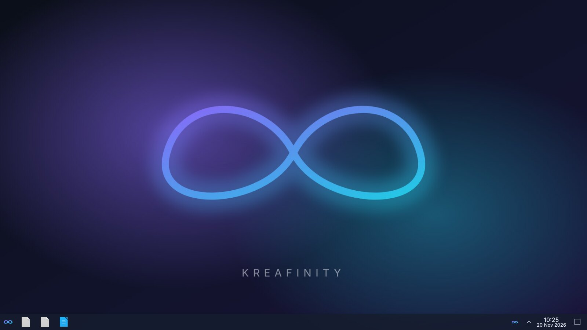
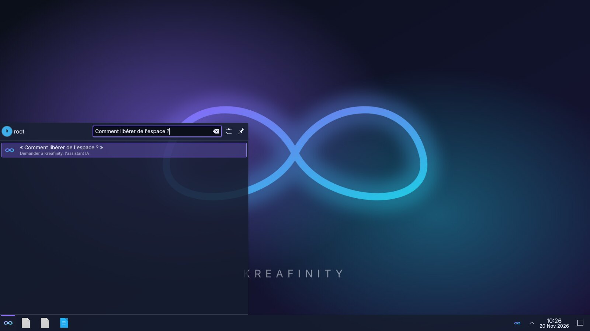
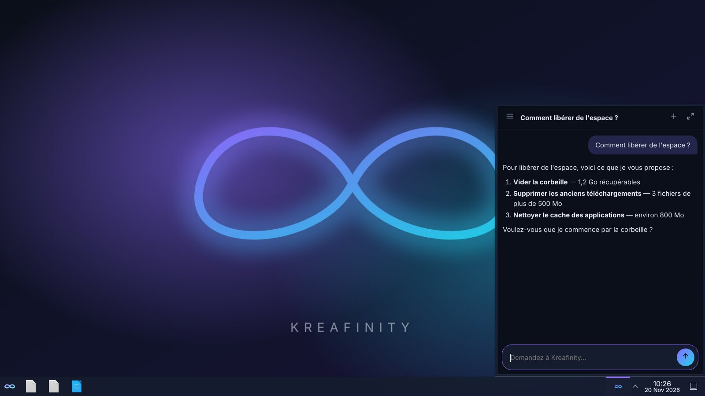
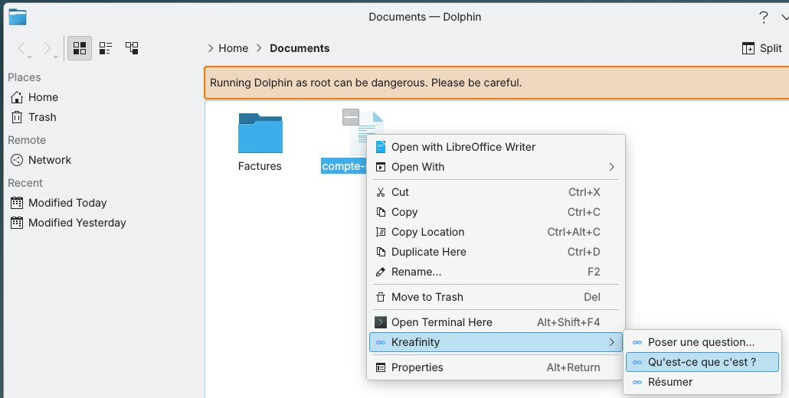

# Kreafinity sur le bureau KDE Plasma

Étape 2 de la feuille de route : un bureau familier, à la façon de Windows, avec l'IA intégrée.
Kreafinity s'appuie sur **KDE Plasma** (barre des tâches, menu démarrer, fenêtres) et y ajoute
l'assistant partout où on en a besoin.



## Ce que ça apporte

**La recherche IA dans le menu démarrer.** Tapez une question dans le menu démarrer (touche
Windows), ou dans la recherche de Plasma (Alt+Espace) : le premier résultat propose de la poser à
Kreafinity. Entrée, et la réponse s'affiche dans le panneau de l'assistant.



**Le bouton ∞ dans la barre des tâches.** Un clic ouvre le panneau de l'assistant au-dessus de
la barre : la même conversation que dans l'interface web, en compact, avec les cartes de
validation des actions. Il s'ouvre aussi tout seul quand vous posez une question depuis la
recherche. Au clavier, **Meta+C** (touche Windows + C, comme Copilot sous Windows) l'ouvre et
le referme. Pour changer ce raccourci : clic droit sur le bouton ∞ › Configurer › Raccourcis
clavier. Si vous en aviez déjà choisi un, il est gardé.



**Kreafinity dans le clic droit des fichiers.** Dans le gestionnaire de fichiers (Dolphin),
un clic droit sur des fichiers ou des dossiers propose un sous-menu **Kreafinity** :

| Action | Pour | Ce que l'assistant fait |
|---|---|---|
| Poser une question… | tout | une petite fenêtre demande votre question sur la sélection |
| Qu'est-ce que c'est ? | tout | il regarde la sélection et vous explique ce que c'est |
| Résumer | fichiers texte | il lit le fichier et le résume |
| Ranger ce dossier | dossiers | il propose un rangement, sans rien déplacer avant votre accord |

La réponse s'affiche dans le panneau ∞. L'assistant regarde les fichiers avec ses outils
habituels : il reste limité aux dossiers autorisés, et toute modification demande votre
validation.



**Le thème Kreafinity.** Couleurs sombres et violettes, fond d'écran Kreafinity et, si vous le
souhaitez, une disposition à la façon de Windows : une seule barre en bas avec le menu
démarrer (logo ∞), les applications ouvertes, l'assistant, la zone de notification et
l'horloge.

Sur Plasma, ce bouton remplace la bulle flottante utilisée sur les autres bureaux.

## Installer

Le script d'installation détecte KDE Plasma et installe tout cela tout seul ; il demande s'il
faut appliquer le thème, et (non par défaut) s'il faut réorganiser le bureau. À tout moment :

```bash
kreafinity desktop install                  # recherche + bouton de la barre des tâches
kreafinity desktop install --theme          # … et les couleurs et le fond d'écran
kreafinity desktop install --layout         # … et la disposition à la façon de Windows
kreafinity desktop remove                   # tout retirer (revient aux couleurs Breeze)
```

`--layout` **remplace vos panneaux actuels** (une confirmation est demandée). Sans cette
option, le bouton ∞ est simplement ajouté à votre barre des tâches existante. Le thème se
retrouve aussi dans Configuration du système › Apparence › Thème global › « Kreafinity ».
`kreafinity desktop` s'écrit aussi `kreafinity bureau`.

## Versions de Plasma

| Plasma | Systèmes | État |
|---|---|---|
| 6 | Debian 13, Kubuntu 25.04 et plus récents, KDE neon, Fedora KDE | Écrit pour l'API de Plasma 6, pas encore essayé sur un vrai bureau Plasma 6 |
| 5.27 | Kubuntu 24.04, Debian 12 | Essayé sur un vrai Plasma 5.27 (captures ci-dessus) |

Le bouton de la barre des tâches a besoin du module QtWebEngine pour QML :
`qml6-module-qtwebengine` (Plasma 6) ou `qml-module-qtwebengine` (Plasma 5), installé par le
script.

## Comment ça marche

- **Recherche** : Plasma interroge un petit programme de Kreafinity par D-Bus (interface
  `org.kde.krunner1`, service `org.kreafinity.KRunner`). D-Bus le démarre à la première
  recherche, grâce au fichier `~/.local/share/dbus-1/services/org.kreafinity.KRunner.service` ;
  Plasma le trouve par `~/.local/share/krunner/dbusplugins/kreafinity.desktop`. Il ne fait que
  proposer le résultat, sans rien envoyer tant que vous ne l'avez pas choisi.
- **Question choisie** : le programme crée une conversation dans le démon avec votre question,
  puis demande aux panneaux de l'afficher (`POST /api/ui/show`). Si aucun panneau n'écoute, la
  conversation s'ouvre dans le navigateur.
- **Bouton ∞** : un widget Plasma (`org.kreafinity.assistant`, dans
  `~/.local/share/plasma/plasmoids`) qui affiche l'interface compacte du démon. Il attend les
  demandes d'affichage (`GET /api/ui/requests`) et s'ouvre quand il en reçoit une.
- **Clic droit des fichiers** : trois menus de service KDE (`kreafinity-*.desktop` dans
  `~/.local/share/kio/servicemenus`, exécutables comme KDE l'exige), réunis dans le même
  sous-menu. Ils lancent `python -m kreafinity.plasma.files_menu ACTION FICHIERS…`, qui envoie la
  question comme la recherche.
- **Raccourci** : le raccourci global du widget (`Meta+C`), enregistré par Plasma lui-même.
- **Thème** : un thème global Plasma (`org.kreafinity.desktop`), un jeu de couleurs
  (`Kreafinity.colors`) et un fond d'écran (`Kreafinity`), dans `~/.local/share`.

Comme pour le reste de Kreafinity, rien ne demande les droits administrateur, et les actions
proposées par l'IA attendent toujours votre validation.

## En cas de problème

**La recherche ne propose pas Kreafinity.** Vérifiez Configuration du système › Recherche ›
Recherche de Plasma : « Kreafinity » doit être coché. Sinon, redémarrez la recherche
(`kquitapp6 krunner`, ou `kquitapp5 krunner` sous Plasma 5) ou ouvrez une nouvelle session.

**Le bouton ∞ n'apparaît pas.** Clic droit sur la barre des tâches › Ajouter des widgets ›
Kreafinity.

**Le panneau reste vide.** Installez le module QtWebEngine (voir plus haut), puis ouvrez une
nouvelle session.

**« Kreafinity ne répond pas »** dans le panneau : le bouton « Démarrer Kreafinity » relance le
démon (`systemctl --user start kreafinity`).

## Pour les développeurs

Les fichiers Plasma sont dans `ui/plasma/` (widget pour Plasma 5 et 6, thème, couleurs, fond
d'écran, description du module de recherche) ; le code Python dans `core/kreafinity/plasma/`.
Pour essayer le widget sans l'installer dans la barre :

```bash
kreafinity desktop install
plasmoidviewer -a org.kreafinity.assistant -f horizontal -l bottomedge
```
