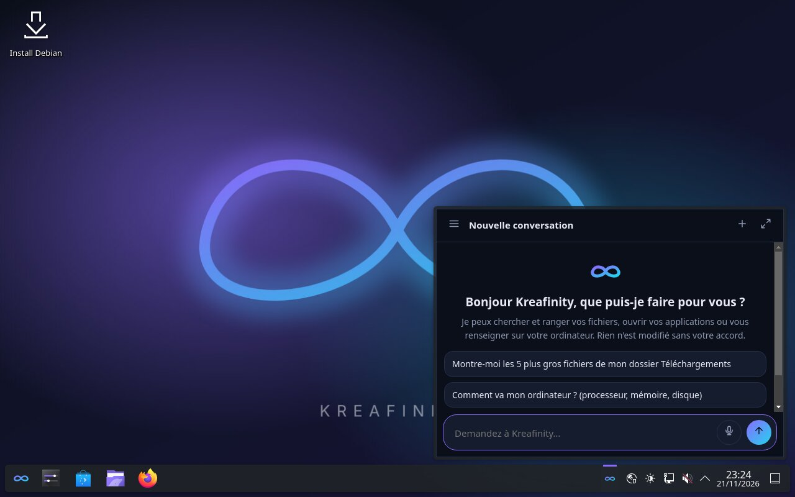
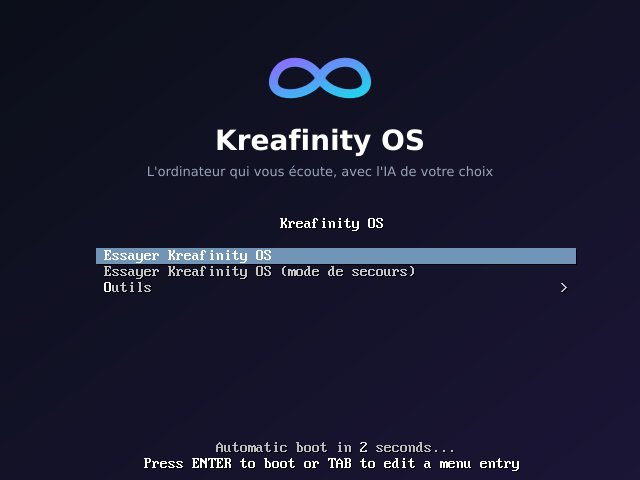
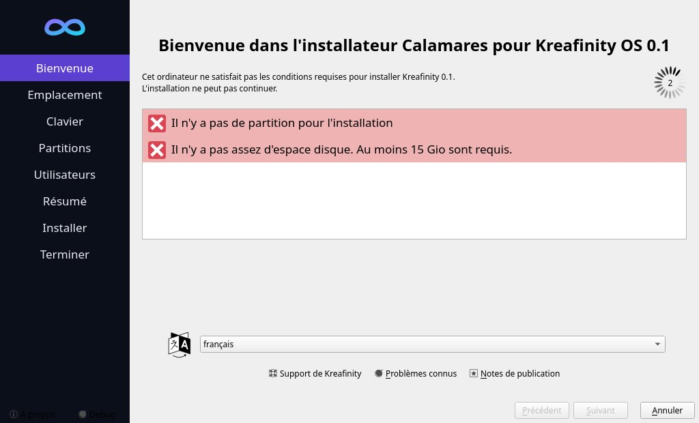

# Étape 3 : la distribution Kreafinity OS

But de l'étape : installer Kreafinity OS comme Windows ou Ubuntu, depuis une clé USB, avec
KDE Plasma, le thème Kreafinity et l'assistant déjà prêts.

| Étape | Contenu | État |
|---|---|---|
| 1 | **Paquet Debian** (`.deb`) de Kreafinity | ✅ fait (ce document) |
| 2 | **Dépôt APT** : `apt install kreafinity` et mises à jour avec le système | ✅ fait, à activer (voir plus bas) |
| 3 | **Image ISO** Debian 13 + KDE Plasma + Kreafinity (live-build) | ✅ fait, à essayer sur de vrais ordinateurs |
| 4 | **Clé USB live** : essayer sans rien installer | ✅ fait (avec l'ISO) |
| 5 | **Installateur graphique** Calamares aux couleurs Kreafinity | ✅ fait |
| 6 | **Premier démarrage guidé** : choisir son IA, préparer la voix | ✅ fait |

## Le paquet Debian

### Ce qu'il contient

Un paquet **autonome** : Kreafinity et **son propre Python** (3.13) sont dans `/opt/kreafinity`.
Le même paquet marche donc sur Debian 12 et 13 et sur Ubuntu 24.04, quel que soit leur Python,
et rien ne se mélange avec les paquets Python du système ou de l'utilisateur.

Pour **tous les utilisateurs** de l'ordinateur :

| Élément | Fichier |
|---|---|
| Commandes `kreafinity` et `kreafinity-core` | `/usr/bin/` |
| Démon (service systemd utilisateur), activé pour tous | `/usr/lib/systemd/user/kreafinity.service` |
| Entrée du menu des applications et icône | `/usr/share/applications/`, `/usr/share/icons/` |
| Bulle à l'ouverture de session (sauf sur KDE, qui a son widget) | `/etc/xdg/autostart/kreafinity-bubble.desktop` |
| KDE : recherche du menu démarrer | `/usr/share/krunner/dbusplugins/`, `/usr/share/dbus-1/services/` |
| KDE : widget ∞ de la barre des tâches (Plasma 5 ou 6, choisi à l'installation) | `/usr/share/plasma/plasmoids/` |
| KDE : thème global, couleurs, fond d'écran | `/usr/share/plasma/look-and-feel/`, `color-schemes/`, `wallpapers/` |
| KDE : sous-menu Kreafinity du clic droit (Dolphin) | `/usr/share/kio/servicemenus/` |

Les données de chacun (réglages, conversations, mémoire, modèles de voix) restent dans son
dossier personnel, comme avec le script d'installation.

### Construire le paquet

```bash
packaging/debian/build-deb.sh            # → dist/kreafinity_<version>_amd64.deb (≈ 50 Mo)
```

Il faut `uv` (qui télécharge le Python du paquet), `dpkg-deb` et un accès à Internet (PyPI).
La version vient du projet et du commit : `0.1.0~dev0+git20261121.abc1234`. Le script vérifie
que Kreafinity démarre avec le seul contenu du paquet avant de le construire.

La CI de GitHub construit le paquet à chaque modification, l'installe avec APT sur une machine
propre, l'essaie (commandes, démon, interface web), le désinstalle, puis le garde en
téléchargement : **Actions › le dernier passage › Artifacts › kreafinity-deb**.

### Installer, mettre à jour, retirer

```bash
sudo apt install ./kreafinity_0.1.0~dev0+git20261121.abc1234_amd64.deb
```

APT installe aussi ce qui est recommandé : `pkexec` (installation de logiciels), GTK et
WebKitGTK (la bulle), les outils du son. Le démon démarre à la prochaine ouverture de session ;
d'ici là, « Kreafinity » dans le menu le lance aussi. Sur KDE Plasma, chaque utilisateur peut
ajouter le widget à sa barre et le raccourci Meta+C avec `kreafinity desktop install`.

- **Mises à jour** : le bouton « Mettre à jour » de l'interface (ou `kreafinity update`).
  Chaque modification de `main` publie le paquet dans les **Releases** de GitHub
  (`packaging/release/publish.sh`, sans clé ni secret à configurer) ; Kreafinity y cherche
  chaque jour la dernière version, la télécharge, vérifie son empreinte SHA-256 puis
  l'installe avec `pkexec apt-get install` : le système demande le mot de passe, puis
  Kreafinity redémarre. Les 10 dernières versions sont gardées. Une fois le dépôt APT signé en
  place (plus bas), les mises à jour arrivent aussi avec celles du système (`apt upgrade`).
  Les paquets construits avant le 26 novembre 2026 ne savent pas encore se mettre à jour
  ainsi : il faut installer une fois à la main le dernier paquet des Releases.
- **La voix** : `/opt` étant en lecture seule, ses moteurs s'installent dans le dossier de
  l'utilisateur (`~/.local/share/kreafinity/voice/site-packages`).
- **Retirer** : `sudo apt remove kreafinity` (ou `purge`). Les données de chacun restent ; pour
  les effacer aussi, chaque utilisateur lance d'abord `kreafinity uninstall --purge`.

### Essayé

Sur un **Ubuntu 24.04 neuf** (créé avec `mmdebstrap`) : installation avec APT et ses
dépendances, commandes en tant qu'utilisateur ordinaire, question à l'IA, démon et interface
web, message des mises à jour, voix installable dans le dossier de l'utilisateur, puis
`apt remove` et `apt purge` sans rien laisser.

Pas encore essayé sur un vrai **Debian 13** : ses miroirs n'étaient pas accessibles depuis
l'environnement de développement. C'est la base prévue de l'ISO, le prochain essai à faire.

## Le dépôt APT

Le dépôt est publié sur **GitHub Pages**, à l'adresse
<https://lawd-creation.github.io/kreafinity-OS/> : une page explique l'installation, et APT y
trouve les paquets. La CI le reconstruit et le **signe** à chaque modification de `main`
(`.github/workflows/apt.yml`).

### Installer depuis le dépôt

```bash
curl -fsSLo /tmp/kreafinity.deb https://lawd-creation.github.io/kreafinity-OS/kreafinity_latest_amd64.deb
sudo apt install /tmp/kreafinity.deb
```

Le paquet ajoute lui-même le dépôt (`/etc/apt/sources.list.d/kreafinity.sources`, avec la clé
dans `/usr/share/keyrings/kreafinity-archive-keyring.gpg`) : les mises à jour arrivent ensuite
avec celles du système. Il ne touche pas à un dépôt déjà configuré à la main ; `apt purge` le
retire.

### L'activer (une seule fois)

Le dépôt a besoin d'une **clé de signature** : APT refuse un dépôt non signé, et la signature
garantit que les paquets viennent bien de Kreafinity. La partie privée de cette clé ne doit
jamais être dans le code ni envoyée à quelqu'un. Sur votre ordinateur, depuis le dépôt Git :

1. `packaging/apt/new-signing-key.sh` : crée la clé, écrit la clé **publique** dans
   `packaging/apt/kreafinity-archive-keyring.asc` et la clé **privée** dans
   `~/kreafinity-apt-signing-key.asc`.
2. Facultatif : validez et poussez la clé publique
   (`git add packaging/apt/kreafinity-archive-keyring.asc`). Sinon, la CI la tire elle-même du
   secret (`packaging/apt/export-public-key.sh`) pour le paquet et l'ISO ; si elle est
   poussée, la CI vérifie que c'est bien la même clé que le secret.
3. Sur GitHub : **Settings › Secrets and variables › Actions › New repository secret**, nom
   `APT_SIGNING_KEY`, valeur : tout le contenu de `~/kreafinity-apt-signing-key.asc`.
4. Sur GitHub : **Settings › Pages › Source : GitHub Actions**.
5. Gardez la clé privée sur une clé USB, puis effacez-la de l'ordinateur
   (`shred -u ~/kreafinity-apt-signing-key.asc`). Si elle était perdue, il faudrait une nouvelle
   clé, et chaque ordinateur devrait réinstaller le paquet pour l'avoir.

Tant que le secret n'existe pas, la CI construit le paquet mais ne publie rien (un avertissement
le rappelle). Les paquets (et les ISO) construits avant le secret n'ont pas la clé : ils ne
recevront pas de mises à jour, il faudra réinstaller le paquet une fois depuis le dépôt.

### Comment c'est fait

- `packaging/apt/build-repo.sh` : place les paquets dans `pool/`, crée les index (`Packages`),
  le fichier `Release` avec leurs sommes de contrôle, le signe (`Release.gpg`, `InRelease`) et
  publie la clé publique, le fichier `kreafinity.sources`, le dernier paquet
  (`kreafinity_latest_amd64.deb`) et la page d'accueil.
- Chaque publication remplace la précédente : le dépôt contient la dernière version.
- Les numéros de version contiennent la date et l'heure du commit
  (`0.1.0~dev0+git20261121.143012.abc1234`) : ils augmentent toujours, et APT propose chaque
  nouvelle version.

### Essayé

Sur un **Ubuntu 24.04 neuf**, avec une clé de test et le dépôt servi localement : installation
exactement comme l'indique la page, dépôt ajouté par le paquet, `apt update` sans
avertissement, puis une version 2 publiée et installée par `apt upgrade`. Et deux attaques
refusées par APT : un index modifié (« taille inattendue ») et un dépôt signé par une autre clé
(« NO_PUBKEY »).

## L'image ISO

Une image **Debian 13 « trixie » + KDE Plasma 6 + Kreafinity**, construite avec `live-build`
(l'outil officiel de Debian pour ses images live) :

- **En français** par défaut (langue, clavier, fuseau horaire), modifiable à l'installation.
- **Le bureau Kreafinity dès le premier démarrage** : thème global Kreafinity comme thème par
  défaut de chaque session (`/etc/xdg/kdeglobals`), donc la disposition à la façon de Windows
  (barre en bas, menu ∞, assistant à côté de l'horloge, Meta+C), les couleurs et le fond
  d'écran.
- **Kreafinity installé** (le paquet Debian), son démon démarrant avec la session.
- **Le quotidien** : Firefox, Dolphin, Kate, Okular, Gwenview, Spectacle, l'archiveur, la
  calculatrice, le réseau, le son, le Bluetooth, l'impression, et les micrologiciels courants
  (Wi-Fi…).
- **Essai sans rien installer** (session live, utilisateur `kreafinity`, sans écran de
  verrouillage) et **installation** avec Calamares aux couleurs Kreafinity (icône « Installer
  Kreafinity OS » sur le bureau et dans le menu), en français.
- **Menu de démarrage Kreafinity** : logo, « Essayer Kreafinity OS » (démarrage automatique
  après 5 secondes), mode de secours.



| Menu de démarrage | Installateur |
|---|---|
|  |  |

(Les deux messages rouges de l'installateur viennent de la machine de test, sans disque.)

### Essayé

Une image construite pour de vrai (2,6 Go), démarrée dans QEMU (BIOS, processeur émulé, sans
accélération graphique) : menu de démarrage, session live en français ouverte toute seule,
**bureau Kreafinity** (fond d'écran, barre des tâches en bas, menu ∞, assistant à côté de
l'horloge), démon Kreafinity démarré avec la session, et **Meta+C ouvre l'assistant**
(capture ci-dessus).

À savoir pour cette première version :

- dans QEMU sans accélération (processeur émulé, environ 20 fois plus lent, et dessin des
  fenêtres par le processeur), KWin et plasmashell plantent : KWin signale sans arrêt que « son
  fil principal a bloqué » avant de s'arrêter. Ce sont les limites de cette machine de test ;
  à vérifier sur de vrais ordinateurs et dans VirtualBox ou GNOME Boxes (avec KVM) ;
- l'accueil de Calamares, son logo et ses couleurs ont été vérifiés avec le Calamares de l'image
  (capture ci-dessus) ; l'installation complète sur un disque reste à essayer ;
- pas encore essayé en UEFI ni sur un vrai ordinateur ;
- sans clé API ni Ollama, l'assistant ne peut pas encore répondre : le premier démarrage guidé
  (choisir son IA) viendra ensuite.

### Construire l'ISO

Sur GitHub : **Actions › ISO › Run workflow**. L'image (environ 3 Go) est ensuite dans
**Artifacts › kreafinity-os-iso** pendant 14 jours, avec sa somme de contrôle SHA-256. Elle
est aussi construite pour chaque version publiée (étiquette `v0.2.0`…).

Ou sur un ordinateur sous Debian 13, en tant que root (environ 30 minutes et 15 Go) :

```bash
sudo apt install live-build mount squashfs-tools xorriso
packaging/debian/build-deb.sh dist                    # le paquet Kreafinity
sudo packaging/iso/build-iso.sh dist/kreafinity_*.deb dist
```

### La mettre sur une clé USB

Avec **Balena Etcher** ou **Ventoy** (Windows, macOS, Linux), ou sous Linux :

```bash
sudo dd if=kreafinity-os-<version>-amd64.iso of=/dev/sdX bs=4M status=progress conv=fsync
```

(`/dev/sdX` est la clé USB : vérifiez avec `lsblk`, tout son contenu est effacé.) Démarrez
l'ordinateur sur la clé (touche F12, F2 ou Échap selon les modèles) : Kreafinity OS s'ouvre
directement sur le bureau, sans rien installer. L'icône « Installer » lance l'installation.

### Comment c'est fait

- `packaging/iso/build-iso.sh` : configure `live-build` (Debian 13, dépôts main et
  non-free-firmware, comme les images officielles, paramètres de démarrage en français), y ajoute notre
  configuration et le paquet Kreafinity, puis construit l'ISO hybride (BIOS et UEFI, CD ou
  clé USB).
- `packaging/iso/config/` : la liste des paquets, les réglages par défaut du bureau
  (`includes.chroot/etc/xdg/`) et un script qui vérifie l'image (Kreafinity présent, démon
  activé) et met le français par défaut.
- `packaging/iso/config/includes.chroot/etc/calamares/branding/kreafinity/` : les couleurs, le
  logo et le diaporama de l'installateur ; `packaging/iso/config/bootloaders/` : le menu de
  démarrage.
- `includes.chroot/usr/lib/live/config/1200-kreafinity-nolock` : coupe le verrouillage de
  l'écran de la session live seulement (personne ne connaît son mot de passe) ; un système
  installé garde son écran de verrouillage.

## Le premier démarrage

Tant qu'aucune IA ne peut répondre (pas de clé pour le fournisseur choisi, Ollama absent ou
sans le modèle), l'**accueil** s'ouvre tout seul à l'ouverture de session (`kreafinity welcome
--if-needed`, lancé par `/etc/xdg/autostart/kreafinity-welcome.desktop`) et à l'ouverture de
l'assistant :

1. **Bienvenue** : ce que fait Kreafinity.
2. **Quelle IA ?** : sur l'ordinateur (Ollama, gratuit et privé), Claude, GPT, Mistral,
   OpenRouter ou Ollama Cloud.
3. **Avec une clé** : la clé est vérifiée auprès du fournisseur puis rangée dans le trousseau
   (lien vers la page où l'obtenir). **Avec Ollama** : un modèle proposé selon la mémoire de
   l'ordinateur (`qwen2.5:3b` ou `qwen2.5:7b`, et `qwen2.5vl:7b` qui voit l'écran), téléchargé
   avec une barre de progression ; si Ollama n'est pas installé, la commande officielle à
   lancer (Kreafinity ne lance jamais rien avec les droits administrateur à votre place).
4. **La voix** (facultatif) : préparée en arrière-plan.
5. **C'est prêt** : Meta+C, les validations, et des exemples pour commencer.


« Plus tard » referme l'accueil sans rien changer ; il revient tant qu'aucune IA n'est prête.
Une fois terminé, il ne s'ouvre plus seul : **Réglages › Relancer l'accueil** le rouvre
(`kreafinity bienvenue` aussi). API : `GET /api/setup`, `POST /api/setup/complete`,
`POST /api/setup/ollama/pull` (événements `ollama_pull`).
