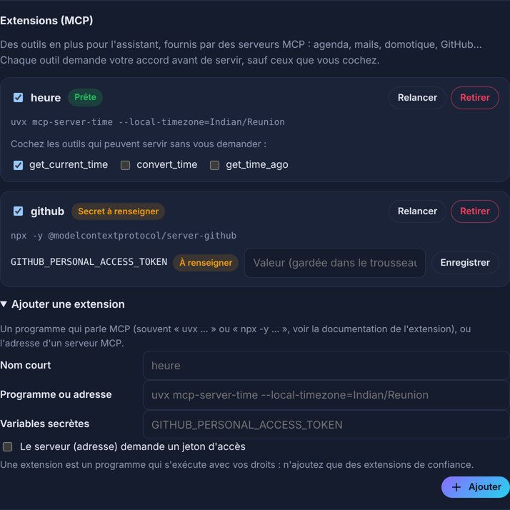

# Extensions MCP : des outils en plus pour l'assistant

Le **Model Context Protocol** (MCP) est un standard ouvert pour brancher des outils sur une IA.
Des centaines de serveurs MCP existent déjà : agenda, mails, GitHub, bases de données,
domotique (Home Assistant), recherche web, notes… Kreafinity peut s'y connecter : leurs outils
deviennent des outils de l'assistant, **avec les mêmes garde-fous que les autres**.



## Ajouter une extension

Dans **Réglages › Extensions (MCP) › Ajouter une extension** : un nom court, puis la commande
qui lance le serveur (indiquée dans sa documentation, souvent `uvx …` ou `npx -y …`) ou son
adresse (`https://…`). Ou en ligne de commande :

```bash
# L'heure et les fuseaux horaires (serveur de référence de MCP)
kreafinity mcp add heure -- uvx mcp-server-time --local-timezone=Indian/Reunion

# GitHub : le jeton est demandé puis rangé dans le trousseau
kreafinity mcp add github --secret GITHUB_PERSONAL_ACCESS_TOKEN -- npx -y @modelcontextprotocol/server-github

# Un serveur à une adresse, avec un jeton d'accès (dans le trousseau)
kreafinity mcp add maison --url http://homeassistant.local:8123/mcp_server/sse --token

kreafinity mcp list                         # état et outils de chaque extension
kreafinity mcp approve heure get_current_time   # cet outil peut servir sans demander
kreafinity mcp remove github                # retire l'extension et ses secrets
```

`uvx` vient de [uv](https://docs.astral.sh/uv/) (`pipx install uv` ou
`curl -LsSf https://astral.sh/uv/install.sh | sh`), `npx` de Node.js (`sudo apt install npm`).

Dans le fichier de configuration (`~/.config/kreafinity/config.yaml`) :

```yaml
mcp_servers:
  heure:
    command: uvx
    args: [mcp-server-time, --local-timezone=Indian/Reunion]
    auto_approve: [get_current_time]       # outils qui servent sans demander
  github:
    command: npx
    args: [-y, "@modelcontextprotocol/server-github"]
    secret_env: [GITHUB_PERSONAL_ACCESS_TOKEN]   # valeur dans le trousseau
    env: {GITHUB_API_URL: https://api.github.com}   # variables sans secret
  maison:
    url: http://homeassistant.local:8123/mcp_server/sse
    token: true                            # jeton dans le trousseau
    enabled: false                         # désactivée pour l'instant
```

## Garde-fous

- **Chaque outil d'extension demande votre accord** avant de servir (comme ouvrir une
  application), avec le détail des valeurs envoyées. Seuls les outils que **vous** cochez (ou
  listez dans `auto_approve`) servent sans demander. Un outil que le serveur déclare comme
  modifiant ou supprimant des données demande la validation explicite (case à cocher).
- **Ce que disent les serveurs n'est jamais une instruction** : leurs descriptions et leurs
  réponses sont des données, et aucune « indication » d'un serveur ne fait servir un outil sans
  votre accord.
- **Les secrets restent dans le trousseau** : une variable dont le nom ressemble à un secret
  (`…TOKEN`, `…KEY`, `…SECRET`, `…PASSWORD`…) est refusée dans le fichier de configuration ;
  elle se déclare dans `secret_env` et sa valeur va dans le trousseau. Les serveurs ne reçoivent
  pas les clés de Kreafinity : seulement quelques variables du système (`PATH`, `HOME`, la
  langue, l'affichage…), leurs variables et leurs secrets.
- **Seul vous ajoutez des extensions** : l'assistant n'a aucun outil pour en installer.
- **Une extension est un programme qui s'exécute avec vos droits** : n'ajoutez que des
  extensions de confiance, comme pour n'importe quel logiciel.
- Les messages d'un serveur sont dans `~/.local/share/kreafinity/mcp/<nom>.log`.

## Comment c'est fait

- `core/kreafinity/mcp/` : la configuration (`config.py`), un petit client MCP (`client.py` :
  JSON-RPC 2.0 sur l'entrée/sortie standard d'un programme, ou en HTTP « Streamable HTTP »
  avec réponses en flux SSE), le gestionnaire des serveurs (`manager.py` : démarrage en
  arrière-plan, redémarrage si un serveur s'arrête, état) et les outils (`tools.py`).
- Seuls les **outils** MCP sont pris en charge pour l'instant (pas encore les ressources ni les
  modèles de requêtes). Les demandes du serveur vers Kreafinity (échantillonnage…) sont
  refusées poliment, sauf `ping`.
- Les outils s'appellent `mcp_<extension>_<outil>` ; une image renvoyée par un outil est montrée
  à l'IA (si son modèle lit les images).
- API : `GET /api/mcp`, `POST /api/mcp/servers`, `PATCH|DELETE /api/mcp/servers/{nom}`,
  `PUT /api/mcp/servers/{nom}/secrets/{variable}`, `POST /api/mcp/servers/{nom}/restart`.

Essayé avec le serveur de référence `mcp-server-time` (lancé par `uvx`) : poignée de main,
liste des outils, appels, erreurs ; et avec un faux serveur couvrant la pagination, les images,
les erreurs, l'arrêt brutal (redémarrage automatique) et le transport HTTP.
