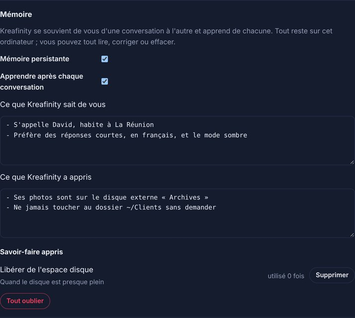

# La mémoire de Kreafinity

Kreafinity se souvient de vous d'une conversation à l'autre, et apprend de chacune. Le principe
s'inspire de **Hermes Agent** (Nous Research) : l'assistant tient lui-même ses notes, les relit au
début de chaque conversation, et les améliore avec le temps.

## Ce dont il se souvient

- **Ce qu'il sait de vous** : votre prénom, vos préférences (« réponses courtes », « mode
  sombre »), vos habitudes, ce dont vous avez souvent besoin.
- **Ce qu'il a appris** : votre ordinateur (« les photos sont sur le disque Archives »), vos
  conventions, et les corrections que vous lui avez faites.
- **Ses savoir-faire** : quand une tâche en plusieurs étapes a réussi (libérer de l'espace,
  ranger des factures…), il note comment il a fait. La prochaine fois, il relit ce savoir-faire
  avant de commencer, et le corrige s'il trouve mieux ou si vous le reprenez.
- **Vos conversations passées** : il peut y chercher ce qui a été dit (« comme la dernière
  fois », « le fichier dont je t'ai parlé la semaine dernière »).

## Comment il s'améliore

Pendant une conversation, Kreafinity enregistre ce qu'il apprend d'important. Puis, deux minutes
après la fin d'une conversation, il la **relit** : il ajoute ce qui mérite d'être retenu, corrige
ce qui est devenu faux, supprime ce qui ne sert plus, et enregistre ou améliore un savoir-faire si
une tâche a réussi. Un petit message « Kreafinity a enrichi sa mémoire » apparaît alors dans
l'interface.

Cette relecture est un appel de plus à votre IA (gratuit avec Ollama, facturé avec une IA en
ligne). Vous pouvez la désactiver en gardant la mémoire : Réglages › Mémoire › « Apprendre après
chaque conversation ».

## Vous gardez la main

- **Tout est visible et modifiable** : Réglages › Mémoire montre ce que Kreafinity sait de vous et
  ce qu'il a appris (modifiable comme un texte), et ses savoir-faire (supprimables un par un).
  En ligne de commande : `kreafinity memory`.
- **Tout s'efface** : bouton « Tout oublier », ou `kreafinity memory --forget`. Vos conversations
  sont gardées (elles s'effacent dans l'historique).
- **Tout peut s'éteindre** : décochez « Mémoire persistante » (ou `memory: false` dans
  `~/.config/kreafinity/config.yaml`) ; l'assistant ne voit alors plus ses notes et ne peut plus
  en écrire.
- **Rien ne quitte l'ordinateur** : la mémoire est dans `~/.local/share/kreafinity/memory/`
  (fichiers lisibles par vous seul), hors de portée des outils de fichiers de l'IA. Elle n'est
  envoyée qu'à l'IA que vous avez choisie, au début de chaque conversation.

## Garde-fous

- Les mots de passe, clés API, jetons et clés privées sont **refusés** : ils ne sont jamais
  enregistrés, même si l'IA essaie.
- La mémoire est présentée à l'IA comme des **informations, jamais des ordres** : une note ne
  peut accorder aucune permission. Les actions sur l'ordinateur demandent toujours votre
  validation, savoir-faire ou pas.
- Les notes sont courtes et limitées en taille (4 000 caractères par carnet, 40 savoir-faire) :
  Kreafinity doit choisir ce qui compte, et fusionner ou oublier le reste.

## Pour les développeurs

- `core/kreafinity/memory.py` : les carnets (`user.md`, `notes.md`) et les savoir-faire
  (`skills/<nom>.md`), les limites et le refus des secrets.
- Outils : `memory` (ajouter, remplacer, supprimer une note), `skill` (lire, enregistrer,
  supprimer un savoir-faire), `search_conversations` (recherche plein texte dans l'historique,
  SQLite FTS5, accents ignorés).
- `core/kreafinity/agent/review.py` : la relecture après une conversation (consignes, transcription,
  suivi de ce qui a déjà été relu) ; elle est lancée par le service du démon.
- API : `GET /api/memory`, `PUT /api/memory/{user|notes}`, `DELETE /api/memory/skills/{nom}`,
  `DELETE /api/memory` ; événement `memory_updated`.
