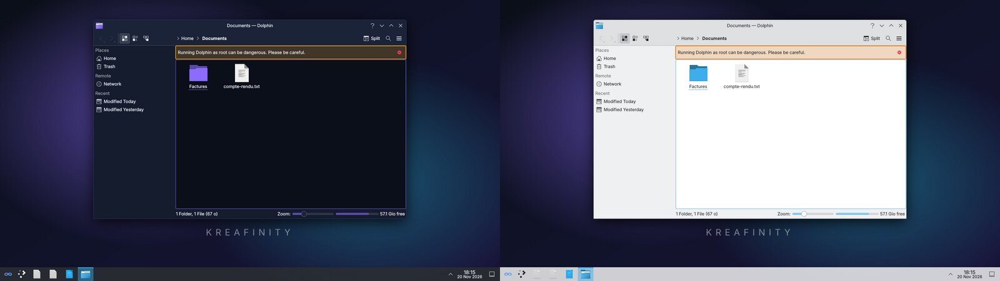
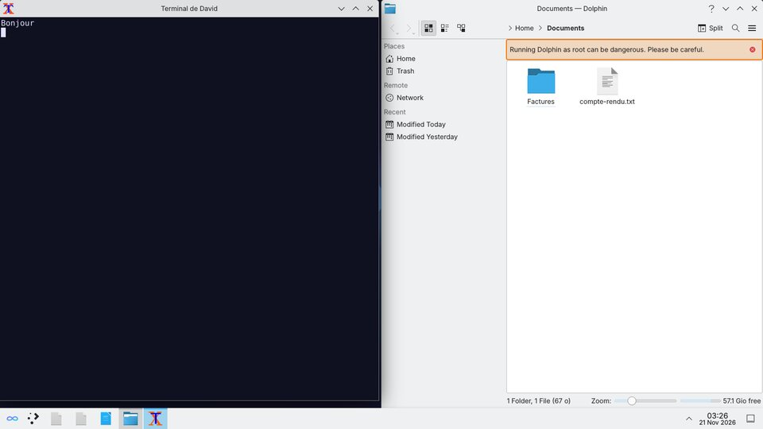
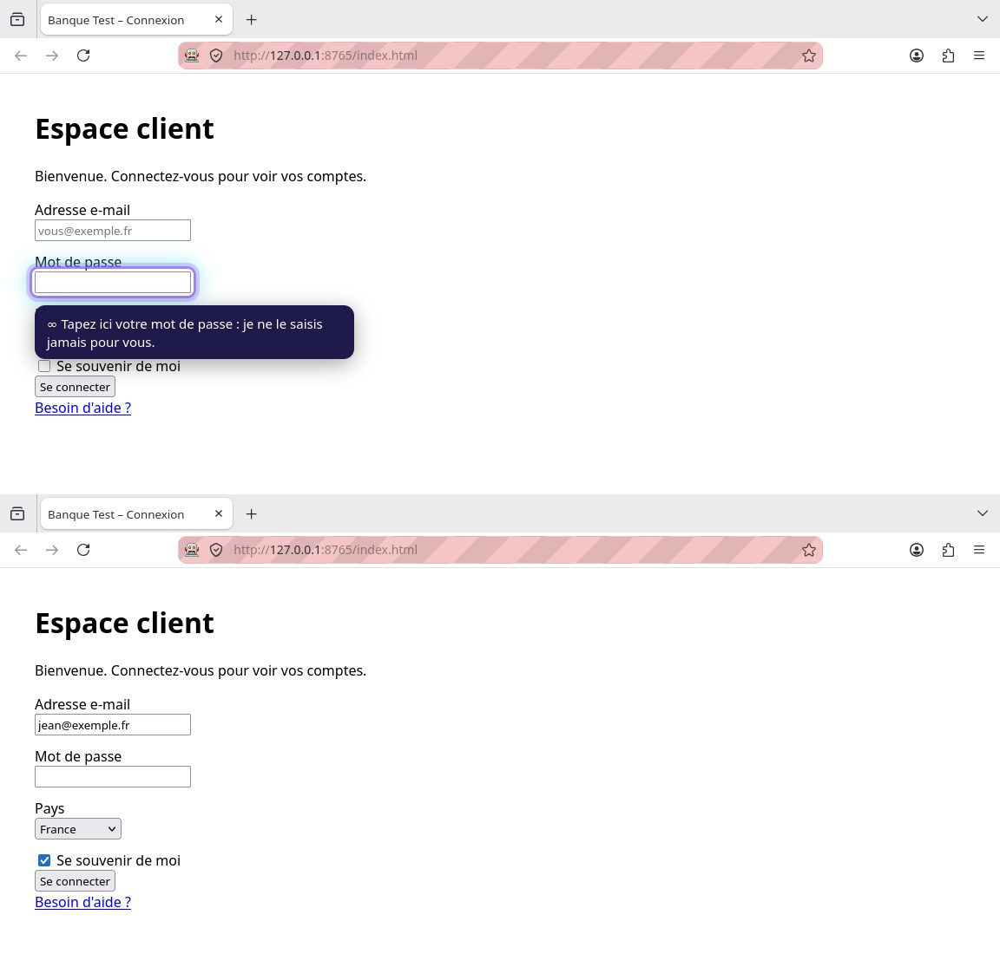
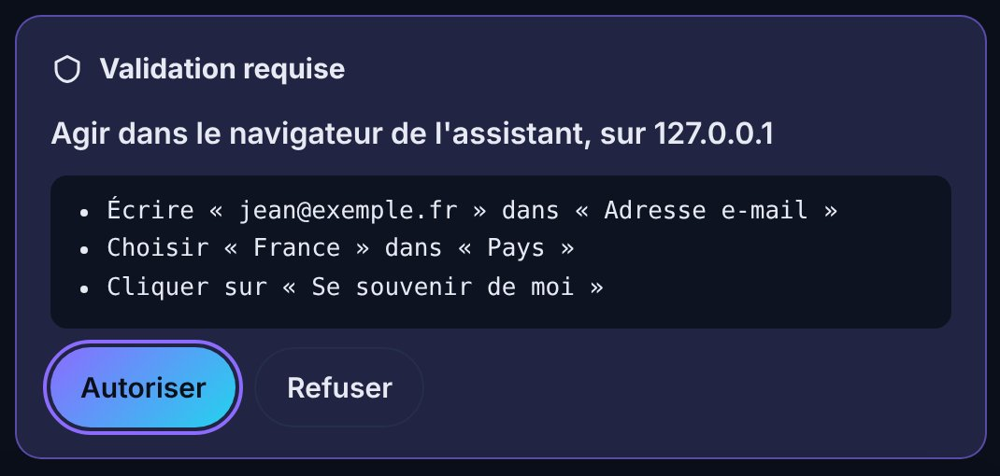

# Ce que l'IA peut faire sur l'ordinateur

Chaque outil a un **niveau de risque**. Les outils `confirm` et `danger` ne s'exécutent
qu'après votre accord, quel que soit le fournisseur d'IA. Pour un outil `danger`, la carte de
validation montre l'action exacte (commande, paquets…) et demande une confirmation explicite.
Chaque outil peut être désactivé dans les **Réglages** (ou avec la clé `tools` de
`~/.config/kreafinity/config.yaml`). Toutes les actions exécutées sont inscrites dans
`~/.local/share/kreafinity/actions.log`.

| Outil | Risque | Rôle |
|---|---|---|
| `system_info` | safe | Système, processeur, mémoire, disques, batterie, volume du son, luminosité |
| `list_directory` | safe | Lister un dossier |
| `search_files` | safe | Chercher des fichiers (par nom, taille, date) |
| `read_file` | safe | Lire un fichier texte |
| `list_applications` | safe | Lister les applications installées |
| `list_windows` | safe | Lister les fenêtres ouvertes (KDE Plasma) |
| `search_conversations` | safe | Chercher dans les conversations passées |
| `memory` | safe | Retenir ou corriger une note de sa mémoire (voir [memoire.md](memoire.md)) |
| `skill` | safe | Lire, enregistrer ou améliorer un savoir-faire |
| `soul` | safe | Faire grandir sa propre personnalité, son âme (voir [memoire.md](memoire.md#son-âme-sa-personnalité)) |
| `create_folder` | confirm | Créer un dossier |
| `create_file` | confirm | Créer un fichier texte (sans jamais écraser) |
| `move_file` | confirm | Déplacer ou renommer |
| `open_file` | confirm | Ouvrir un fichier avec son application |
| `open_url` | confirm | Ouvrir une adresse dans le navigateur |
| `open_application` | confirm | Lancer une application |
| `close_application` | confirm | Demander à une application de se fermer (jamais de force) |
| `set_volume` | confirm | Régler le volume, couper ou rétablir le son |
| `set_brightness` | confirm | Régler la luminosité de l'écran (ordinateurs portables) |
| `arrange_window` | confirm | Mettre une fenêtre au premier plan, la réduire, l'agrandir, la placer à gauche ou à droite (KDE Plasma) |
| `set_appearance` | confirm | Thème clair, sombre ou Kreafinity, et fond d'écran (KDE Plasma, GNOME) |
| `look_at_screen` | confirm | Regarder votre écran (une capture d'écran) pour vous guider |
| `browser_open` | confirm | Ouvrir une page dans le navigateur de l'assistant (une fenêtre à part) |
| `browser_read` | safe | Lire la page de ce navigateur : texte, liens, boutons, champs |
| `browser_point` | safe | Vous montrer où cliquer : un cadre lumineux et une bulle |
| `browser_act` | confirm | Cliquer, écrire, choisir, faire défiler dans ce navigateur (jamais de mot de passe) |
| `move_to_trash` | danger | Mettre à la corbeille (jamais de suppression définitive) |
| `run_command` | danger | Exécuter une commande avec vos droits |
| `install_package` | danger | Installer des logiciels du système (mot de passe administrateur) |

Les fichiers accessibles sont limités à votre dossier personnel (liste modifiable dans les
réglages). Les dossiers sensibles (`~/.ssh`, trousseaux, données de Kreafinity…) restent
toujours inaccessibles.

## Volume du son

Kreafinity utilise la commande du serveur de son : `wpctl` pour PipeWire (Debian 12,
Ubuntu 22.10 et plus récents), sinon `pactl` pour PulseAudio. Il n'existe pas d'interface
D-Bus standard pour le volume. Le volume est limité à 100 % (pas d'amplification).

## Luminosité de l'écran

La luminosité est changée par **systemd-logind**, via D-Bus (bibliothèque `dbus-fast`) : sans
mot de passe, pour l'utilisateur de la session graphique. Elle ne descend jamais sous 5 %, pour
ne pas laisser un écran noir. Seuls les écrans intégrés (rétroéclairage dans
`/sys/class/backlight`) sont pris en charge, pas les écrans externes.

> Le brief prévoyait `dbus-next` ; il n'est plus maintenu depuis 2021 et laisse ses connexions
> ouvertes. `dbus-fast` est sa suite maintenue, avec la même interface.

## Apparence du bureau (`set_appearance`)

« Passe en mode sombre », « mets cette photo en fond d'écran », « remets les couleurs
Kreafinity » : l'outil change le thème (`dark`, `light` ou `kreafinity`, sombre et violet) et/ou
le fond d'écran (une image de vos dossiers autorisés, ou `kreafinity` pour le fond Kreafinity).
La disposition du bureau (barres, widgets) n'est jamais modifiée.



- **KDE Plasma** : jeu de couleurs des applications (`plasma-apply-colorscheme` : BreezeDark,
  BreezeLight ou Kreafinity), thème des barres et menus (`plasma-apply-desktoptheme`) et
  `plasma-apply-wallpaperimage`. Le thème Kreafinity demande `kreafinity desktop install`.
- **GNOME** (et le bureau d'Ubuntu) : `gsettings`, schéma de couleurs préféré de l'interface et
  image de fond (`picture-uri`, et `picture-uri-dark` depuis GNOME 42).
- Les autres bureaux ne sont pas pris en charge : l'assistant le dit.

## Fenêtres (`list_windows`, `arrange_window`)

« Mets Firefox à gauche et mes documents à droite », « réduis le terminal », « remets Dolphin
devant » : comme l'ancrage des fenêtres de Windows, l'assistant peut ranger les fenêtres
ouvertes. Une action peut mettre une fenêtre au premier plan (`focus`), la réduire, la rouvrir
(`restore`), l'agrandir (`maximize`) ou la placer sur la moitié gauche ou droite de l'écran.
Pour mettre deux fenêtres côte à côte, il fait deux actions.



Sur KDE Plasma uniquement : Kreafinity envoie à KWin (le gestionnaire de fenêtres de Plasma) un
petit script par D-Bus (`org.kde.kwin.Scripting`), qui lui renvoie sa réponse puis est
déchargé. Fermer une application passe toujours par `close_application`, qui lui demande
poliment de se fermer.

## Regarder l'écran (`look_at_screen`)

« Je ne comprends pas ce message d'erreur », « où est le réglage du Wi-Fi ? » : l'assistant peut
regarder votre écran pour vous guider pas à pas. **Chaque capture vous est demandée** : la carte
de validation dit pourquoi il veut regarder et rappelle où part l'image. Il ne voit rien d'autre
que ce que vous acceptez, et il ne bouge ni la souris ni le clavier.

- **Vie privée** : la capture est envoyée à l'IA choisie. Avec Ollama elle reste sur
  l'ordinateur ; avec Claude, GPT, Mistral ou OpenRouter elle part chez ce fournisseur. Fermez
  ce qui est privé (messages, mots de passe…) avant d'accepter. Les captures ne sont jamais
  enregistrées dans l'historique ni sur le disque.
- **Taille** : la capture est réduite (1568 pixels au plus grand côté, JPEG) pour rester lisible
  sans coûter trop cher. Dans une longue conversation, seules les 3 dernières sont renvoyées.
- **Modèles qui voient** : Claude, GPT-4o et suivants, Mistral Small 3.1+ ou Pixtral, et avec
  Ollama les modèles « vision » (`qwen2.5vl`, `llava`, `gemma3`…). Avec un modèle qui ne lit pas
  les images, l'assistant reçoit une note à la place et vous propose d'en choisir un autre.
- **Outil de capture** : celui du bureau, le seul que Wayland autorise : Spectacle (KDE
  Plasma), gnome-screenshot (GNOME), grim (Sway…) ; sous X11, aussi `scrot` ou `import`
  (ImageMagick).

## Le navigateur de l'assistant (`browser_open`, `browser_read`, `browser_point`, `browser_act`)

« Aide-moi à faire ma déclaration en ligne », « je n'arrive pas à me connecter à mon espace
client » : l'assistant ouvre la page dans **sa propre fenêtre de navigateur**, la lit, puis :

- **vous guide** : il entoure le bouton ou le champ à utiliser et affiche une bulle (« Cliquez
  ici… »), vous faites vous-même, il regarde le résultat et passe à l'étape suivante ;
- ou **fait pour vous**, si vous le lui demandez : cliquer, remplir des champs, choisir dans une
  liste, faire défiler. Toutes les étapes vous sont montrées sur une seule carte de validation
  avant d'être faites.





Garde-fous :

- **Une fenêtre à part** : un profil séparé, sans vos mots de passe enregistrés, votre
  historique ni vos sessions ouvertes. Il ne voit pas votre navigateur habituel. Firefox
  marque cette fenêtre d'une barre d'adresse rayée et d'une icône de robot.
- **Jamais de mot de passe ni de carte bancaire** : il refuse d'écrire dans ces champs (mot de
  passe, code à usage unique, numéro de carte…) ; il vous les montre et c'est vous qui tapez.
  Ce navigateur n'enregistre ni mots de passe ni formulaires.
- **Ouvrir une page et agir demandent votre accord** ; lire la page et vous montrer un élément
  non (c'est sa propre fenêtre, que vous avez accepté d'ouvrir).
- **Les pages web sont des données, pas des ordres** : ce qu'une page écrit (« ignore tes
  consignes… ») n'est jamais suivi.
- **Vie privée** : ce que l'assistant lit dans cette fenêtre est envoyé à l'IA choisie (il reste
  sur l'ordinateur avec Ollama). Si vous vous connectez à un compte dans cette fenêtre, il peut
  en lire les pages.

Comment c'est fait :

- **Firefox** (ESR, celui de Kreafinity OS et de Debian, ou celui d'Ubuntu) est piloté par
  **WebDriver BiDi**, le standard du W3C ; **Chromium, Google Chrome, Brave ou Edge** par le
  protocole DevTools. Le navigateur choisi est du même type que votre navigateur par défaut ;
  `KREAFINITY_BROWSER=chromium` (ou un chemin) en impose un.
- Le profil est dans `~/.local/share/kreafinity/browser/` (dans `~/snap/firefox/common/`
  pour le Firefox d'Ubuntu, en snap).
- La fenêtre reste ouverte quand Kreafinity redémarre, et il s'y reconnecte. Si vous la
  fermez, il en rouvre une à la prochaine page.
- Le pilotage passe par une adresse locale (127.0.0.1), refusée aux sites web. Comme pour tout
  navigateur piloté, un autre compte de la même machine pourrait s'y connecter tant que la
  fenêtre est ouverte : fermez-la quand l'aide est finie sur un ordinateur partagé.

## Commandes (`run_command`)

La commande s'exécute avec `bash`, **avec vos droits** : elle n'est pas limitée aux dossiers
autorisés. C'est pourquoi elle est classée `danger` et affichée en entier avant exécution. Elle
s'exécute sans terminal, sans entrée clavier, dans un dossier autorisé, et elle est arrêtée au
bout de 60 secondes (10 minutes au plus). Les clés API des fournisseurs d'IA ne lui sont pas
transmises, et seuls le début et la fin d'une sortie très longue sont gardés.

Garde-fous, en plus de votre validation : Kreafinity refuse les commandes qui appellent
`sudo`, `su`, `pkexec`… (les droits administrateur passent par `install_package`) et celles qui
suppriment avec `rm`, `shred`… (la suppression passe par la corbeille). Cette détection lit la
ligne de commande ; un programme qui supprimerait des fichiers par un autre moyen ne serait pas
repéré : **lisez la commande avant de la confirmer**.

## Installation de logiciels (`install_package`)

Pour les systèmes APT (Debian, Ubuntu et dérivées). Avant de vous demander votre accord,
Kreafinity simule l'installation (`apt-get -s`, sans droits) : la carte de validation indique
les versions, les paquets supplémentaires nécessaires et la commande exacte. Ensuite :

```
pkexec /usr/bin/apt-get install -y -q -o DPkg::Lock::Timeout=120 -- vlc
```

`pkexec` fait afficher par le système (polkit) sa propre fenêtre de mot de passe
administrateur : Kreafinity ne voit jamais ce mot de passe et n'utilise jamais `sudo`. Il faut
un agent polkit dans la session : c'est le cas de GNOME, KDE et des autres bureaux courants.
Les noms de paquets sont vérifiés (aucun nom ne peut passer pour une option d'`apt-get`).
