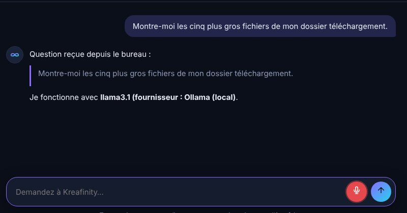
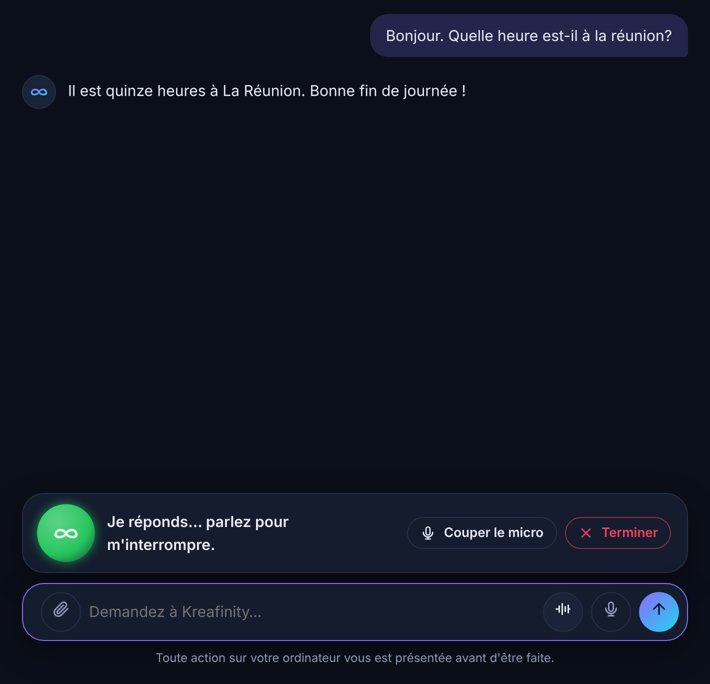

# Parler à Kreafinity

Cliquez sur le **micro** à côté du champ de saisie, parlez, puis cliquez à nouveau : Kreafinity
écrit ce que vous avez dit, l'envoie, et vous répond **à voix haute**. Ça marche dans
l'interface web, dans le panneau ∞ de la barre des tâches (KDE Plasma) et dans la bulle.



## Installer la voix

La voix est facultative : il faut environ **600 Mo** (moteurs et modèles), téléchargés une seule
fois. Deux façons :

- dans l'interface : **Réglages › Voix › Préparer la voix** (l'avancement s'affiche) ;
- en ligne de commande :

```bash
kreafinity voice install      # moteurs Whisper et Piper, modèle de reconnaissance, voix française
kreafinity voice              # état de la voix
```

## Sur l'ordinateur, sans rien envoyer

Par défaut, tout se passe **sur votre ordinateur**, même sans Internet :

- **Reconnaissance** : [Whisper](https://github.com/SYSTRAN/faster-whisper) (faster-whisper).
  Trois précisions au choix : rapide (140 Mo), équilibrée (460 Mo, par défaut), précise (1,5 Go,
  plus lente). Sur un processeur courant, une phrase de quelques secondes est comprise en 2 à
  4 secondes.
- **Lecture à voix haute** : une voix [Piper](https://github.com/OHF-Voice/piper1-gpl) (voix
  française « siwis », 60 Mo). La mise en forme est retirée avant la lecture : pas de « astérisque »
  ni de code lu à voix haute, et les adresses web sont sautées.

Les modèles sont rangés dans `~/.local/share/kreafinity/voice` ; l'enregistrement de votre voix
n'est gardé nulle part : il est transcrit puis oublié.

## La conversation orale

Le bouton **Conversation orale** (l'onde, à côté du micro) ouvre une conversation à voix haute,
sans rien toucher, à la façon de Gemini Live :

- **Parlez quand vous voulez** : Kreafinity détecte quand vous commencez et quand vous avez fini
  (un petit silence), puis envoie ce que vous avez dit.
- **Il répond à voix haute phrase par phrase**, pendant que la réponse s'écrit (sans lire le
  code ni la mise en forme). Le texte reste affiché dans la conversation.
- **Coupez-lui la parole** : si vous parlez pendant qu'il répond, il se tait, arrête la demande
  en cours et vous écoute.
- **Couper le micro** met la conversation en pause ; **Terminer** la ferme.
- Les actions à valider s'affichent comme d'habitude : il vous le dit à voix haute et attend
  votre clic.



Tout se passe **sur l'ordinateur** (reconnaissance Whisper, voix Piper) : seul le texte va à l'IA
choisie. La détection de la parole se fait dans la page, avec l'annulation d'écho du navigateur,
pour que la voix de Kreafinity ne soit pas prise pour la vôtre. Comptez quelques secondes entre
la fin de votre phrase et le début de la réponse (reconnaissance, IA, voix) : moins instantané
que Gemini Live, dont le modèle entend directement le son, mais avec l'IA de votre choix.

## Réglages

Dans **Réglages › Voix** (ou dans `~/.config/kreafinity/config.yaml`) :

| Réglage | Valeurs | Par défaut |
|---|---|---|
| Reconnaissance de la voix (`voice_input`) | `local` (sur l'ordinateur), `openai` (en ligne), `off` | `local` |
| Précision (`voice_model`) | `base`, `small`, `medium` | `small` |
| Réponses à voix haute (`voice_reply`) | `voice` (après une question posée à voix haute), `always`, `never` | `voice` |

Avec `openai`, l'enregistrement est envoyé à l'API de transcription d'OpenAI avec votre clé
OpenAI (celle du trousseau) : plus rapide sur un petit ordinateur, mais votre voix quitte la
machine. La lecture à voix haute reste toujours locale.

## Le micro

Le navigateur demande la permission d'utiliser le micro la première fois. Dans le panneau ∞ et
la bulle, Kreafinity l'autorise lui-même, **pour sa propre page uniquement** (jamais la caméra,
jamais une autre page). Un enregistrement dure au plus une minute.

## Pour les développeurs

- `core/kreafinity/voice/` : `audio.py` (décodage en 16 kHz mono avec PyAV), `stt.py`
  (Whisper local, API d'OpenAI), `tts.py` (Piper, texte à lire), `manager.py` (état,
  préparation en arrière-plan, utilisé par le démon).
- API : `GET /api/voice`, `POST /api/voice/prepare`, `POST /api/voice/transcribe` (le corps de
  la requête est l'enregistrement), `POST /api/voice/speak` (`{"text": …}` → `audio/wav`) ;
  événement `voice_updated`.
- Interface : `ui/web/js/voice.js` (MediaRecorder, lecture des réponses).
- Les dépendances sont l'extra `voice` du paquet (`pip install "kreafinity-os[voice]"`).
